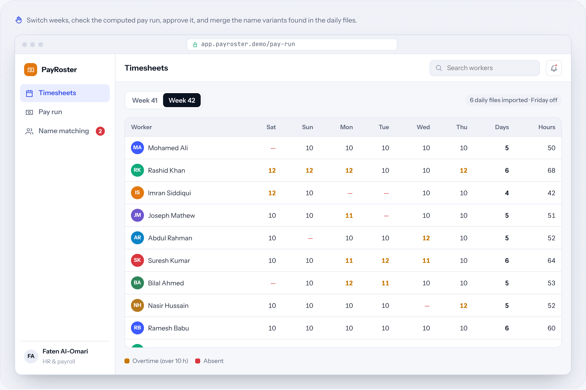
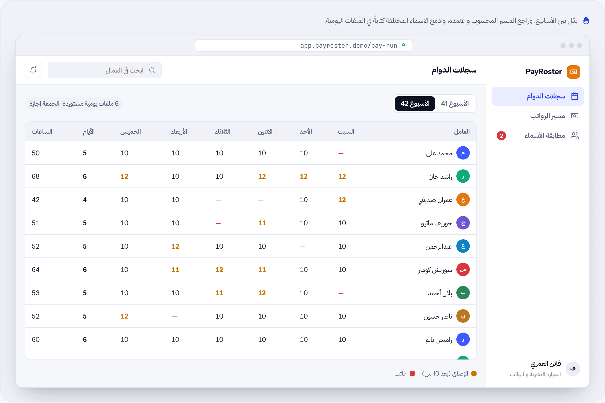

# PayRoster

**Timesheets → payroll statements** · Business systems · by [HUDERA AI](https://www.linkedin.com/company/hudera)

Combines daily timesheet files into weekly pay runs with overtime, flags name variants, and locks the run once approved.

**[▶ Try the live demo](https://hudera-ai.github.io/payroster/)** · runs in your browser on sample data · Arabic & English

## The problem
Each day produces a separate timesheet, typed by different supervisors. At week end someone merges them by hand and pays from a spreadsheet that is easy to get wrong.

## What it does
PayRoster imports the daily files, matches workers even when names are spelled differently, computes days, overtime and pay with your rates, and produces the pay statement for approval.

## Business value
Pay runs are consistent and traceable to the daily records, and the merge work that took hours is reduced to a review.

## Features
| Feature | Details |
| --- | --- |
| Daily imports | Excel files, any supervisor |
| Name matching | Merge spelling variants safely |
| Overtime rules | Per day thresholds and rates |
| Pay statement | Your company template |
| Approval lock | Approved runs can't change |
| Search & filter | By worker and week |

## How the workflow runs
**Import**: Daily timesheets → **Match**: Worker names → **Compute**: Days & overtime → **Review**: Pay run → **Export**: Pay statement

## Typical stack
Python · Excel automation · Web review screen

## Run it locally
Open `index.html` in any modern browser. No build step, no server, no data leaves your machine.

---

## PayRoster بالعربي

**سجلات الدوام ← مسيرات الرواتب**

يجمع ملفات الدوام اليومية في مسيرات رواتب أسبوعية مع الإضافي، وينبّه على اختلاف كتابة الأسماء، ويقفل المسير بعد اعتماده.

### المشكلة
كل يوم له سجل دوام منفصل يكتبه مشرف مختلف. في نهاية الأسبوع يدمجها أحدهم يدوياً ويصرف من جدول يسهل الخطأ فيه.

### ما الذي يفعله
يستورد PayRoster الملفات اليومية، ويطابق العمال حتى لو اختلفت كتابة الأسماء، ويحسب الأيام والإضافي والأجر بأسعارك، ويُخرج كشف الصرف للاعتماد.

### القيمة للأعمال
مسيرات الرواتب متسقة ويمكن تتبعها إلى السجلات اليومية، وعمل الدمج الذي كان يأخذ ساعات أصبح مراجعة فقط.

### المزايا
| الميزة | التفاصيل |
| --- | --- |
| استيراد يومي | ملفات Excel من أي مشرف |
| مطابقة الأسماء | دمج الأسماء المختلفة كتابةً بأمان |
| قواعد الإضافي | حدود وأسعار لكل يوم |
| كشف الصرف | قالب شركتك |
| قفل بعد الاعتماد | المسير المعتمد لا يتغير |
| بحث وتصفية | حسب العامل والأسبوع |

### كيف يسير العمل
**الاستيراد**: سجلات الدوام اليومية ← **المطابقة**: أسماء العمال ← **الحساب**: الأيام والإضافي ← **المراجعة**: مسير الرواتب ← **التصدير**: كشف الصرف

---

## About HUDERA AI
HUDERA AI builds WhatsApp AI assistants, business dashboards, workflow automations and custom SaaS products for companies in Saudi Arabia and the Gulf.

- LinkedIn: [linkedin.com/company/hudera](https://www.linkedin.com/company/hudera)
- Email: hudera.ai@gmail.com
- WhatsApp: [+20 155 515 9139](https://wa.me/201555159139)

> This repository is a product demo. Company names, people and figures inside it are fictional sample data.

© 2026 HUDERA AI. All rights reserved.
